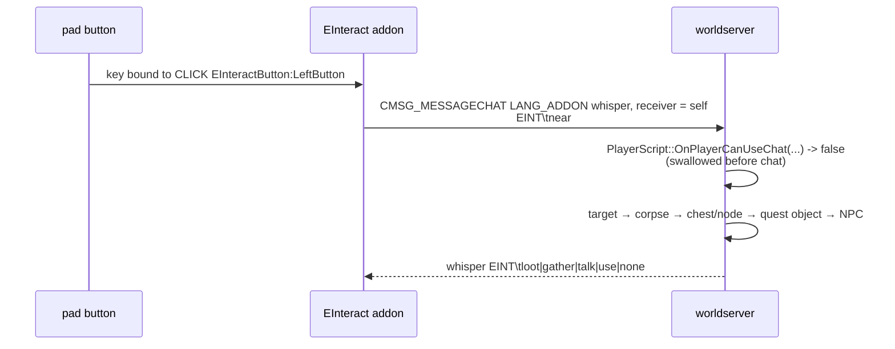

# One interact key (`mod-e-interact`)

## Problem

The realm is played on a handheld with a pad, and the loot loop is mouse work: right-click the
corpse, right-click the node, right-click the NPC. On the Thor that means the pad's trackpad and its
click buttons for every kill, and a corpse the camera cannot see is a corpse you cannot take. The
client cannot help: 3.3.5a has no API to enumerate nearby units or objects, and `InteractUnit` is
protected.

## What is installed

Two halves:

- **server:** `modules/mod-e-interact`, vendored from
  `Rainblower/mod-e-interact` at the commit in `pins.toml` (MIT). Local diff in
  `modules/mod-e-interact/UPSTREAM.md`.
- **client:** the `EInteract` add-on, shipped by the launcher as assets
  (`acore-thor-launcher/app/src/main/assets/einteract/`) and installed into
  `Interface/AddOns` beside ConsolePortLK. It declares a client binding - a click binding on a
  hidden button, `CLICK EInteractButton:LeftButton` - instead of taking a literal key, and appends a
  named row for it to ConsolePort's `/cp` list, so the button that fires the interact key is assigned
  in ConsolePort's own menu.

## How the key works

The add-on cannot do the work, so it uses a **self-addressed addon whisper as a private RPC**:



`sScriptMgr->OnPlayerCanUseChat` is the hook that swallows it (`Player.cpp:9694` in the pinned core
calls it for whispers before delivery), so the message never reaches chat and no custom opcode is
needed. The module then runs the code the client's own packets reach, which is what keeps every
check intact:

| Action | What the module calls |
|---|---|
| Loot a corpse | `HandleLootOpcode` (through `CanPacketReceive`, so `mod-aoe-loot` still merges) → `HandleLootMoneyOpcode` → `HandleAutostoreLootItemOpcode` per free slot → `HandleLootReleaseOpcode` |
| Skin / herb / mine a corpse | `CastSpell` with the gathering spell, after the same skill check `Spell::CheckCast` does |
| Loot a chest, herb or ore node | `Player::SendLoot(guid, LOOT_CORPSE)` — the call `Spell::EffectOpenLock` uses, which generates the loot, then the same money → autostore → release chain |
| Quest object / NPC window | `HandleGameObjectUseOpcode`, or `QueuePacket(CMSG_GOSSIP_HELLO | CMSG_QUESTGIVER_HELLO | CMSG_LIST_INVENTORY | …)` — the packets a right click sends |
| Mailbox | `HandleGetMailList` with the object's GUID (`CanOpenMailBox` checks distance and type; a mailbox has no `Use()` case) |
| Quest dialog, Need/Greed rolls | the add-on alone (`QuestFrame` buttons, `ConfirmLootRoll`), so these work without the module |

### Order

Current target → nearest lootable corpse → nearest chest/node → nearest questgiver object →
nearest mailbox → nearest live NPC, all within the normal interaction distance (the searches reach
`INTERACTION_DISTANCE + 5`). Group rules are respected: items under a roll, under master loot, or
won by someone else stay on the corpse or object.

## The key is a binding, not a key

The first version of this module shipped the opposite: the add-on called
`SetOverrideBindingClick(frame, true, "E", "EInteractButton")` at login. That is a global override,
invisible to every UI, and it collided with ConsolePortLK, which is what drives the pad.

The add-on now uses a normal client binding: a click binding on its hidden button.

```lua
SetBindingClick("E", "EInteractButton")   -- what the first run writes
GetBindingKey("CLICK EInteractButton:LeftButton")
```

Three things follow from that:

- The client stores it in its own binding table, so the Key Bindings frame lists it, the player can
  rebind or clear it there, `/ei key <key>` moves it, and the choice survives in SavedVariables.
  Nothing re-adds it after the first run - an unbound key is a choice too.
- ConsolePort's menu is built on demand from `ConsolePort:GetCustomBindings()`
  (`ConsolePort/Frames/Atlas.lua:691`), and a click binding from another add-on has no
  `BINDING_NAME_*` global, so it would show the raw binding string. The add-on wraps that function -
  never replaces it - and appends `{ name = "Interact with the nearest thing", binding = "CLICK
  EInteractButton:LeftButton" }`, the same shape ConsolePort uses for its own actions
  (`CLICK ConsolePortUtilityToggle:LeftButton` and friends). The row then appears in `/cp` and any
  pad button can be assigned to it.
- The launcher's own controller profile is what a pad button becomes before the game sees it, so
  the button works out of the box: `ensureLocalControllerProfile` (`WoWForeverScreen.kt`) maps the
  Thor's pad to keys - Y/B/A/X to F9-F12, the d-pad to F1-F4, Select/Start/Mode to F5/F6/KP_Multiply,
  the shoulders to F7/F8 and Shift/Ctrl, the left stick to WASD, the right stick to mouse movement -
  and the left stick click to `E`, which is the key this add-on binds on its first run.

### What that means for `/cp`

`PhysicalControllerHandler.onKeyEvent` consumes a button that has a profile binding and sends its
binding instead, so the game never receives those buttons as controller input. A `/cp` row therefore
cannot make a pad button do anything - the key does.

Worse, ConsolePort's L3 and R3 are **aliases for the real mouse buttons**. `Config/Binds.lua:103-106`
has `mouseBindings = { ["CP_T_L3"] = "BUTTON1", ["CP_T_R3"] = "BUTTON2" }`, the shipped controller sets
give those two buttons empty binding tables (`Controllers/XBOX/Xbox.lua:188-189`), and `SetTempBinding`
(`Config/Binds.lua:441`) resolves a logical button through `GetBindingKey(name) or
config.mouseBindings[name]` and calls `SetOverrideBinding(handler, false, modifier .. "BUTTON1", action)`.
Assigning an action to L3 in `/cp` is therefore assigning it to the left mouse button, and R3 to the
right one. Play testing proved it twice: the row assigned to L3 made the launcher trackpad's
*Left click* run the action, moving the same row to R3 moved it to *Right click*, and neither stick
click did anything, because their presses are consumed by the profile and never reach ConsolePort.

That is not fixable from ConsolePort's side: `CheckCalibration` (`Config/Splash.lua:36`) explicitly
skips the stick clicks - `isDynamicKeyAllowed = not button:match("CP_T_.3")` - so they are never
offered for calibration and can never become real buttons; its own help says to assign each stick
click to the matching mouse button (`ConsolePortHelp/Pages/Controller.lua:83`). L3 and R3 are the
mouse buttons, permanently.

So: leave ConsolePort's L3 and R3 rows empty. The pad's own click buttons are the mouse. To give a
stick click an arbitrary action, bind it to a key in the launcher's controller profile and bind that
key in the client's Key Bindings frame - a client binding, not a `/cp` action.

### What the two stick clicks do

| Button | The launcher sends | The game does |
|---|---|---|
| L3 (left stick click) | the `E` key (`ensureLocalControllerProfile`) | EInteract's binding: loot, gather, talk, open |
| R3 (right stick click) | the right mouse button | a right click - the client's `TURNORACTION`, which is what ConsolePort's R3 means by default |

R3's right click only applies where this launcher's own R3 cursor toggle is off, which is the local
realm's default (`R3ToggleDefaultTest`: ConsolePort drives the right stick there); `onKeyEvent` handles
that toggle before any profile binding, so the other flavours keep their cursor switch. The profile is
the player's after the first launch: moving either stick click is an edit to it, and `/ei key <key>`
moves the interact key without touching the profile.

ConsolePort's own interact bindings (right-click simulation, "Interact With Mouseover") need the
cursor on the target or a mouseover unit, and its "smart interaction" setting only caches friendly
nameplate GUIDs to retarget in range, so neither overlaps this module.

Nothing is shared between the two halves at runtime: the module answers a whisper that never leaves
the player, and ConsolePort never sees it.

## The gameobject pass (local change)

Upstream walks creatures only, so chests, herb and ore nodes and questgiver objects did nothing —
the largest gap for a solo realm that lives on gathering. `EInteract.Use` (default 1) adds:

- `CanOpenObject()`: the lock is read the way `Spell::CanOpenLock` reads it, without a spell to
  take the lock type from — an item key in the bags (`LOCK_KEY_ITEM`), the gathering or lockpicking
  skill the lock asks for (`LOCK_KEY_SKILL` against `LockEntry::Skill`), or a spell the lock names
  (`LOCK_KEY_SPELL`). No lock means open to everyone.
- `LootGameObject()`: `Player::SendLoot` generates the loot exactly as a right click would, then the
  same money → autostore → release chain. The release is what deactivates an emptied node, so
  respawn and restock timers stay stock.
- `TryGameObject()`: `GAMEOBJECT_TYPE_CHEST` through `SendLoot`, `GAMEOBJECT_TYPE_QUESTGIVER`
  through `HandleGameObjectUseOpcode`, `GAMEOBJECT_TYPE_MAILBOX` through `HandleGetMailList`.
  Doors, buttons, traps, goobers and battleground flags are deliberately untouched — they change
  world state rather than give the player something.

Known limits: only the nearest object of each kind is tried, so a looted node makes the key fall
through to the next stage (step sideways and press again); and a node is looted without the
gathering cast, so there is no skill-up or gather animation — the lock check above is what keeps
that from ignoring tool requirements.

## Configuration and layout

`$PREFIX/etc/modules/mod_e_interact.conf` (`thor-install.sh` creates it and restores any key that
drifted away from 1):

| Key | Effect |
|---|---|
| `EInteract.Enable` | answer the add-on at all |
| `EInteract.Loot` | loot corpses |
| `EInteract.Gather` | skin / herb / mine looted corpses |
| `EInteract.Talk` | open NPC windows |
| `EInteract.Use` | open chests, nodes and questgiver objects (local) |

The tarball carries `etc/modules/mod_e_interact.conf.dist` and nothing else: the module has no SQL
tree, so the DB updater never sees it, and `src/modules/mod-e-interact` is not in the artifact.

## Verification

- Every core API the module calls was checked against the pinned commit `8a4e76e` by hand:
  `ConfigValueCache`, the hook-list `PlayerScript`/`WorldScript` constructors,
  `PLAYERHOOK_CAN_PLAYER_USE_PRIVATE_CHAT`, `WORLDHOOK_ON_BEFORE_CONFIG_LOAD`,
  `WorldObject::GetDeadCreatureListInGrid`/`FindNearestGameObjectOfType`, `Player::isAllowedToLoot`
  / `SendLoot` / `GetNPCIfCanInteractWith` / `HasItemCount` / `GetSkillValue` / `HasSpell`,
  `Loot::LootItemInSlot`, `WorldSession::HandleLoot*` / `HandleGameObjectUseOpcode`,
  `ScriptMgr::CanPacketReceive`, `ChatHandler::BuildChatPacket`, `sLockStore` + `LockEntry`.
- `EInteract.Use = 1` is asserted in the build (`server-aarch64.yml`), so a build that lost the
  vendored pass fails there.
- The ConsolePort facts above were read in the shipped 1.5.0-rc2 sources: the L3/R3 mouse defaults
  (`Config/Binds.lua:104-105`) and the custom-binding list the `/cp` menu builds
  (`Frames/Atlas.lua:691`). Its own interact bindings need the cursor or a mouseover target, and its
  "smart interaction" setting (`Config/Lookup.lua:801-802`, off by default) only caches
  friendly-nameplate GUIDs to retarget in range.
- The ConsolePort alias behaviour above was read in the shipped 1.5.0-rc2 sources (`mouseBindings`,
  the empty `CP_T_L3`/`CP_T_R3` binding tables, `SetTempBinding`, `SetMouseBindings`) and then
  reproduced on the device: the action followed the row from L3 to R3 and landed on the trackpad's
  left and right click in the same order.
- Play testing on the Thor: the key fires from the pad, and the add-on's answer is what the player
  sees. Two different failures used to print the same red line, so "the module is not installed" and
  "there is nothing here" looked alike; they now read differently (`EInteract: the server has no
  mod-e-interact` against `Nothing to interact with nearby`), and `/ei` reports the server state, the
  bound key and the rest of the settings while `/ei debug` prints the module's actual answer
  (`loot`, `gather`, `talk`, `use`, `none`) in chat. That distinction was checked against a stubbed
  client API: the no-answer path shows the first line and sends no request, the ready path sends
  `near` and shows the second only when the module answers `none`.
- The add-on was run against a stubbed client API: the first login binds `E`, `/ei key F` moves the
  binding, a rebind asked for in combat is deferred and applied on `PLAYER_REGEN_ENABLED`, a relogin
  after the player unbound the key does not re-add it, `/cp` gets the named row, the bound action
  sends `EINT near` once the module answers `ready`, and `/ei off` makes it silent.
- A local `-fsyntax-only` compile was **not** possible on the dev workstation (no Boost headers in
  the rootfs), so the first real compile is the arm64 CI build.
- Not verified anywhere yet: a real 3.3.5a client pressing the bound key, on the Thor or otherwise.
