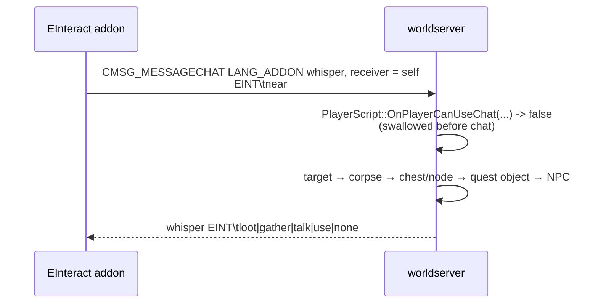

# One interact key (`mod-e-interact`)

## Problem

The realm is played on a handheld with a pad, and the loot loop is mouse work: right-click the
corpse, right-click the node, right-click the NPC. On the Thor that means the pad's trackpad and its
click buttons for every kill, and a corpse the camera cannot see is a corpse you cannot take. The
client cannot help: 3.3.5a has no API to enumerate nearby units or objects, and `InteractUnit` is
protected.

## What is installed

Two halves:

- **server:** `modules/mod-e-interact`, vendored from
  `Rainblower/mod-e-interact` at the commit in `pins.toml` (MIT). Local diff in
  `modules/mod-e-interact/UPSTREAM.md`.
- **client:** the `EInteract` add-on, shipped by the launcher as assets
  (`acore-thor-launcher/app/src/main/assets/einteract/`) and installed into
  `Interface/AddOns` beside ConsolePortLK and ThorPad.

## How the key works

The add-on cannot do the work, so it uses a **self-addressed addon whisper as a private RPC**:

`sScriptMgr->OnPlayerCanUseChat` is the hook that swallows it (`Player.cpp:9694` in the pinned core
calls it for whispers before delivery), so the message never reaches chat and no custom opcode is
needed. The module then runs the code the client's own packets reach, which is what keeps every
check intact:

| Action | What the module calls |
|---|---|
| Loot a corpse | `HandleLootOpcode` (through `CanPacketReceive`, so `mod-aoe-loot` still merges) → `HandleLootMoneyOpcode` → `HandleAutostoreLootItemOpcode` per free slot → `HandleLootReleaseOpcode` |
| Skin / herb / mine a corpse | `CastSpell` with the gathering spell, after the same skill check `Spell::CheckCast` does |
| Loot a chest, herb or ore node | `Player::SendLoot(guid, LOOT_CORPSE)` — the call `Spell::EffectOpenLock` uses, which generates the loot, then the same money → autostore → release chain |
| Quest object / NPC window | `HandleGameObjectUseOpcode`, or `QueuePacket(CMSG_GOSSIP_HELLO | CMSG_QUESTGIVER_HELLO | CMSG_LIST_INVENTORY | …)` — the packets a right click sends |
| Mailbox | `HandleGetMailList` with the object's GUID (`CanOpenMailBox` checks distance and type; a mailbox has no `Use()` case) |
| Quest dialog, Need/Greed rolls | the add-on alone (`QuestFrame` buttons, `ConfirmLootRoll`), so these work without the module |

### Order

Current target → nearest lootable corpse → nearest chest/node → nearest questgiver object →
nearest mailbox → nearest live NPC, all within the normal interaction distance (the searches reach
`INTERACTION_DISTANCE + 5`). Group rules are respected: items under a roll, under master loot, or
won by someone else stay on the corpse or object.

## The gameobject pass (local change)

Upstream walks creatures only, so chests, herb and ore nodes and questgiver objects did nothing —
the largest gap for a solo realm that lives on gathering. `EInteract.Use` (default 1) adds:

- `CanOpenObject()`: the lock is read the way `Spell::CanOpenLock` reads it, without a spell to
  take the lock type from — an item key in the bags (`LOCK_KEY_ITEM`), the gathering or lockpicking
  skill the lock asks for (`LOCK_KEY_SKILL` against `LockEntry::Skill`), or a spell the lock names
  (`LOCK_KEY_SPELL`). No lock means open to everyone.
- `LootGameObject()`: `Player::SendLoot` generates the loot exactly as a right click would, then the
  same money → autostore → release chain. The release is what deactivates an emptied node, so
  respawn and restock timers stay stock.
- `TryGameObject()`: `GAMEOBJECT_TYPE_CHEST` through `SendLoot`, `GAMEOBJECT_TYPE_QUESTGIVER`
  through `HandleGameObjectUseOpcode`, `GAMEOBJECT_TYPE_MAILBOX` through `HandleGetMailList`.
  Doors, buttons, traps, goobers and battleground flags are deliberately untouched — they change
  world state rather than give the player something.

Known limits: only the nearest object of each kind is tried, so a looted node makes the key fall
through to the next stage (step sideways and press again); and a node is looted without the
gathering cast, so there is no skill-up or gather animation — the lock check above is what keeps
that from ignoring tool requirements.

## Configuration and layout

`$PREFIX/etc/modules/mod_e_interact.conf` (`thor-install.sh` creates it and restores any key that
drifted away from 1):

| Key | Effect |
|---|---|
| `EInteract.Enable` | answer the add-on at all |
| `EInteract.Loot` | loot corpses |
| `EInteract.Gather` | skin / herb / mine looted corpses |
| `EInteract.Talk` | open NPC windows |
| `EInteract.Use` | open chests, nodes and questgiver objects (local) |

The tarball carries `etc/modules/mod_e_interact.conf.dist` and nothing else: the module has no SQL
tree, so the DB updater never sees it, and `src/modules/mod-e-interact` is not in the artifact.

## Verification

- Every core API the module calls was checked against the pinned commit `8a4e76e` by hand:
  `ConfigValueCache`, the hook-list `PlayerScript`/`WorldScript` constructors,
  `PLAYERHOOK_CAN_PLAYER_USE_PRIVATE_CHAT`, `WORLDHOOK_ON_BEFORE_CONFIG_LOAD`,
  `WorldObject::GetDeadCreatureListInGrid`/`FindNearestGameObjectOfType`, `Player::isAllowedToLoot`
  / `SendLoot` / `GetNPCIfCanInteractWith` / `HasItemCount` / `GetSkillValue` / `HasSpell`,
  `Loot::LootItemInSlot`, `WorldSession::HandleLoot*` / `HandleGameObjectUseOpcode`,
  `ScriptMgr::CanPacketReceive`, `ChatHandler::BuildChatPacket`, `sLockStore` + `LockEntry`.
- `EInteract.Use = 1` is asserted in the build (`server-aarch64.yml`), so a build that lost the
  vendored pass fails there.
- A local `-fsyntax-only` compile was **not** possible on the dev workstation (no Boost headers in
  the rootfs), so the first real compile is the arm64 CI build.
- Not verified anywhere yet: a real 3.3.5a client pressing E, on the Thor or otherwise.
